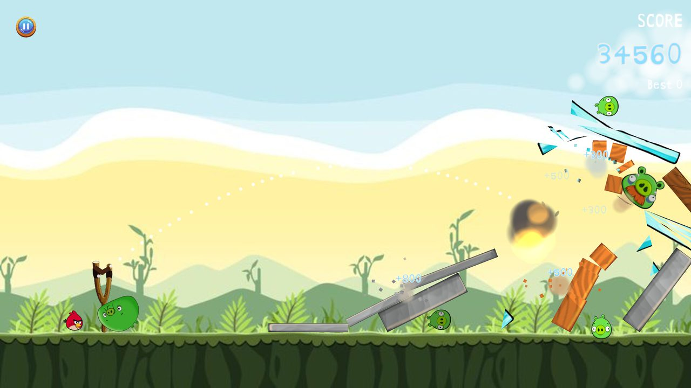
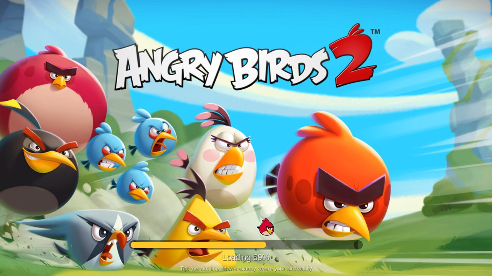
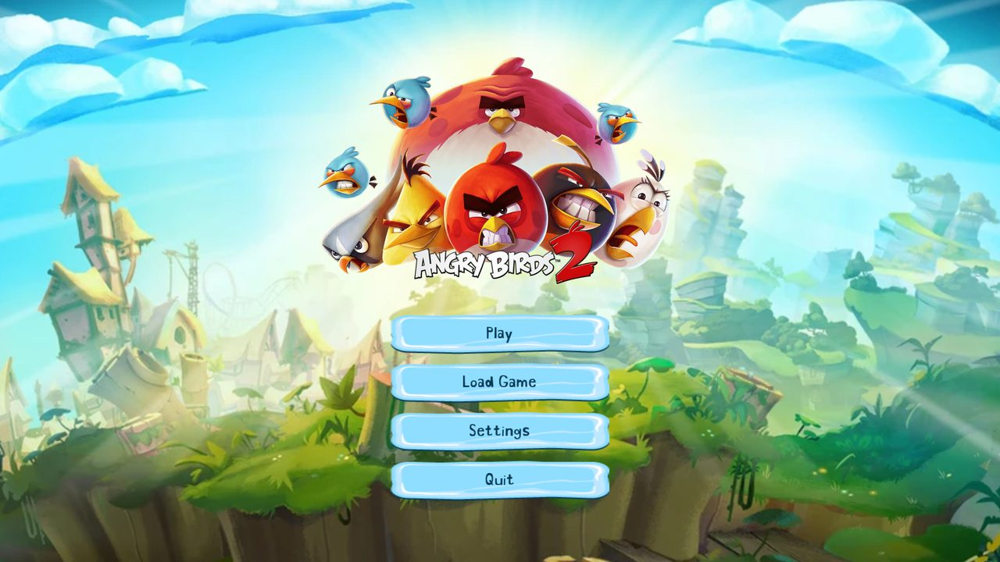
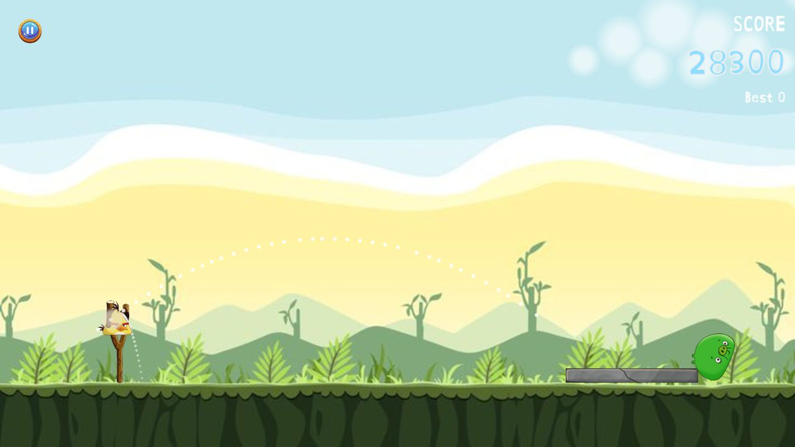
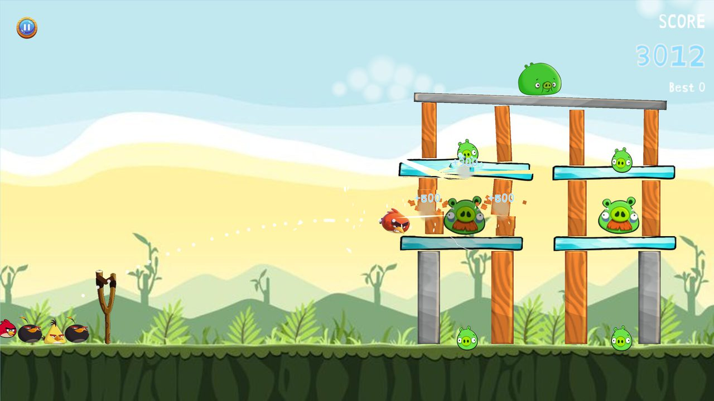
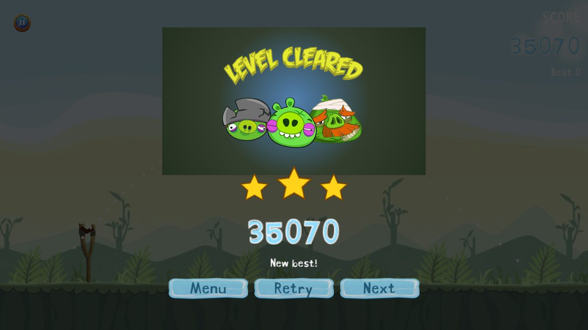
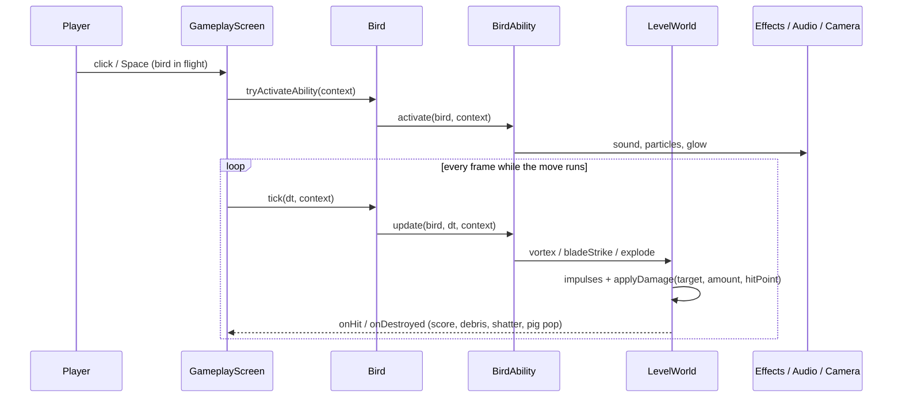
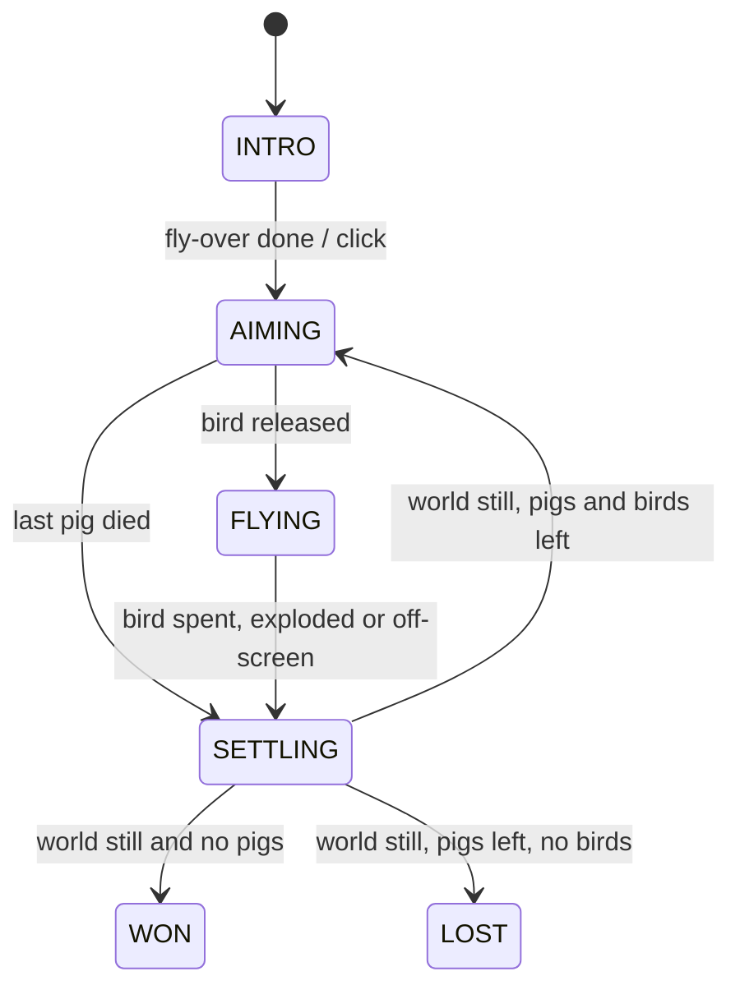
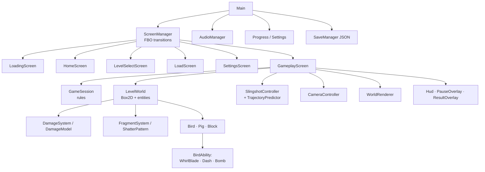

<h1 align="center">AngryHomies</h1>

<p align="center">
  <b>A slingshot physics game built with LibGDX + Box2D.</b><br>
  Real impact damage, material-specific shattering, three special moves, animated screens and sound.
</p>

<p align="center">
  
  
  
  
  
</p>

<p align="center"></p>

> Built for the IIIT-Delhi Advanced Programming course by **2023135** and **2023296**.
> **v2** turns the course submission into a full game. Every change is listed file by file in
> [`CHANGELOG.md`](CHANGELOG.md), and the review behind it is in [`GAME_IMPROVEMENT_PLAN.md`](GAME_IMPROVEMENT_PLAN.md).

---

## Contents

[Features](#features) · [Screenshots](#screenshots) · [Quick start](#quick-start) · [Controls](#controls) ·
[Special moves](#special-moves) · [How it works](#how-it-works) · [Architecture](#architecture) ·
[Tuning](#tuning-knobs) · [Testing](#testing) · [Dev tools](#developer-tools) · [Levels](#adding-a-level) · [Credits](#credits)

## Features

| Area | What you get |
|---|---|
| **Physics** | Fixed 60 Hz timestep with render interpolation: identical results at 30, 60, 120 or 144 Hz. Continuous collision so fast birds can't tunnel through glass. |
| **Damage** | Impact energy (½·μ·v²) from the closing speed along the contact normal. Resting stacks take no damage, falls and hits do. Each material has its own toughness. |
| **Destruction** | Three crack stages, then a material-specific break: glass **shatters** into radial shards from the hit point, wood **splinters** along the grain, stone **cracks** into wedges. Every piece is a textured physics body. |
| **Aiming** | A pull-and-release slingshot with a rubber band that thins as it stretches and springs back. The dotted aim line uses the same integration as Box2D, so it lands exactly where the bird flies. |
| **Special moves** | Red: **Whirlpool Blade**. Yellow: **Speed Dash**. Black: **Bomb**. Each has its own physics, particles, sound and camera feedback. |
| **Game feel** | Opening fly-over, zoom-out to follow high shots, trauma-based screen shake, hit-stop on big hits, slow motion on the last pig, squash and stretch, breathing pigs, after-images, floating score. |
| **Screens** | Async loading bar with a hopping bird, animated menus, crossfade and slide transitions, level cards with stars, a results card that counts up the score and stamps in the stars. |
| **Audio** | 23 procedurally generated effects plus an ambience loop. Pitch variation, volume scaled by impact strength, music crossfade between screens. |
| **Progress** | 1–3 stars per level, best scores, unlocking, settings, and JSON save slots that survive restarts. |
| **Pause** | Freezes the simulation (nothing drifts); volume sliders and an aim-line toggle inside; auto-pauses when the window loses focus. |

## Screenshots

| | |
|---|---|
|  <br> **Async loading** with a real progress bar |  <br> **Home menu**: the logo bounces in, buttons slide in one by one |
|  <br> **Exact aim line** and last-shot trail |  <br> **Whirlpool Blade** splitting wood and glass along the cut |
|  <br> **Bomb**: the blast uses distance to each surface, so stone breaks |  <br> **Results**: score count-up and stamped stars |

## Quick start

```bash
git clone https://github.com/kushiiitd05/ANGRYHOMIES_2023135_2023296.git
cd ANGRYHOMIES_2023135_2023296
./gradlew lwjgl3:run        # play
./gradlew core:test         # run the 30 unit tests (headless, no window)
```

Requires Java 11 or newer (tested on Java 22). Gradle is provided by the wrapper.

## Controls

| Input | Action |
|---|---|
| Drag the bird back, release | Launch |
| Click or <kbd>Space</kbd> in flight | Special move (once per bird) |
| <kbd>Esc</kbd> / <kbd>P</kbd> | Pause |
| <kbd>R</kbd> | Restart level |
| <kbd>F11</kbd> | Fullscreen |
| Click during the fly-over | Skip intro |
| <kbd>↑</kbd> <kbd>↓</kbd> <kbd>Enter</kbd> | Menu navigation |

**Scoring:** pigs 5,000 (king 10,000), blocks 300–800 by material, damage points, and 10,000 per unused bird.

## Special moves

Each move is a **strategy object** (`BirdAbility`). It acts on the level only through `AbilityContext`, so moves never reach into the screen directly.

| Bird | Move | Beat by beat | Strong against |
|---|---|---|---|
| **Red** | Whirlpool Blade | **1. Whirl (0.4 s):** Red brakes, spins up, and a vortex pulls loose pieces in while swirl particles circle him. **2. Strike:** a 48 m cut along his original heading. Everything on the line takes damage reduced only by the square root of its toughness, is knocked aside, and splits at the cut. White slash streak, shake, hit-stop, and Red rockets along the cut. | wood, glass, pigs |
| **Yellow** | Speed Dash | Velocity becomes 2.2× along the heading (capped below Box2D's per-step limit), with after-images, speed streaks, a ring and 1.6× hit damage for the rest of the flight. | wood (2×) |
| **Black** | Bomb | 0.45 s fuse (hiss, red throb, swelling), then a radial impulse and damage that fall off as (1 − d/r)², where *d* is the distance to each object's **surface**. Fireball, smoke, shockwave ring and heavy shake. Detonates by itself 1.6 s after landing. | stone (2.5×) |



## How it works

### Fixed timestep
`PhysicsWorld` collects frame time and advances Box2D in exact 1/60 s steps. Renderers draw each body at
`prev + (cur − prev) · α`, where α is the leftover fraction of a step. A unit test confirms 30, 60 and 144 Hz frame rates produce the same number of steps.

### Damage from real impacts
`DamageSystem` measures the closing speed along the contact normal in `preSolve`, before the solver separates the bodies.
`DamageModel` turns that into energy `E = ½ · μ · v²` (μ is the reduced mass) and divides by the target's toughness, times the bird's material speciality.
Damage is queued and applied after the step (Box2D locks the world during callbacks), and every hit is tied to the **specific object** that was struck.

### Shattering
`ShatterPattern` cuts a block's rectangle into convex pieces that tile it exactly:

- **Glass:** many triangles fanning from the impact point.
- **Stone:** a few wide wedges.
- **Wood:** strips cut across the grain at random points.

`FragmentSystem` builds each piece as a Box2D polygon textured with its exact part of the block (`PolygonRegion`). It keeps the block's momentum plus a kick away from the hit, and fades the piece out after about 2 s.

### Exact aim line
`TrajectoryPredictor` repeats Box2D's semi-implicit Euler (`v += g·dt; p += v·dt`) at the world step.
Because launch *sets* a velocity rather than applying an impulse, the dots match the real flight. A unit test checks this step by step against a live Box2D body.

### Level rules



`GameSession` waits for the world to settle (or a 4.5 s timeout), so a level is never lost while the last pig is still falling.

## Architecture



```
core/src/main/java/com/AngryHomies/AngryBirds/
├── Main.java              app root: services + screen manager
├── assets/                Assets (all paths), ProceduralTextures (particles, clouds, stars, cracks)
├── audio/                 AudioManager, Sfx
├── entity/                GameEntity, Bird/BirdType, Pig/PigType, Block/Material, BodyFactory
│   └── ability/           BirdAbility, AbilityContext, WhirlBladeAbility, DashAbility, BombAbility
├── fx/                    ParticleSystem, Effects, FragmentSystem, ShatterPattern, Clouds
├── gameplay/              PhysicsWorld, DamageSystem, DamageModel, LevelWorld, GameSession,
│                          SlingshotController, TrajectoryPredictor, CameraController, BirdQueue, WorldRenderer
├── level/                 LevelDefinition (JSON levels)
├── save/                  SaveManager, SaveData, Progress, Settings
├── screen/                BaseScreen, ScreenManager, transitions, all screens
└── ui/                    Hud, PauseOverlay, ResultOverlay
```

## Tuning knobs

| Feel | Where |
|---|---|
| Gravity, world size, ground, speed cap | `gameplay/WorldConfig` |
| Launch power, pull reach, fork positions | `gameplay/SlingshotController` |
| Damage scale, minimum impact speed | `gameplay/DamageModel` |
| Material health, toughness, score, sounds | `entity/Material` |
| Pig health and toughness | `entity/PigType` |
| Bird size, density, material specialities | `entity/BirdType` |
| Move strength and timings | `entity/ability/*Ability` |
| Shard counts per material | `fx/ShatterPattern` |
| Shake, zoom, intro timing | `gameplay/CameraController` |
| Mix levels | `audio/Sfx` |

## Testing

`./gradlew core:test` runs 30 tests on the headless libGDX backend with real Box2D:

| Suite | Proves |
|---|---|
| `TrajectoryPredictorTest` | aim line = real Box2D flight at every step; stops at the floor and at obstacles |
| `DamageSystemTest` | resting stacks record no impacts; a fall is attributed to the right entity at the right speed |
| `DamageModelTest` | energy, reduced mass, toughness, blast falloff; a full-speed red bird breaks a small wood block |
| `ShatterPatternTest` | pieces tile the block for every material and size; glass yields more pieces than stone; planks split along the grain |
| `GameSessionTest` | intro, win, loss, return to aiming, settle timeout, no loss while things still move |
| `PhysicsWorldTest` | same simulation at 30, 60 and 144 Hz; zero delta freezes time |
| `LevelDefinitionTest` | every level JSON loads with the original layout; stone art means stone material |
| `SaveManagerTest` | save round-trip; corrupt and old-version saves load as empty |

## Developer tools

| Tool | Use |
|---|---|
| **Demo mode**: `ANGRYHOMIES_DEMO=<dir> [ANGRYHOMIES_DEMO_LEVEL=n] ./gradlew lwjgl3:run` | Plays by itself at low volume: aims each shot at a pig with the trajectory predictor, fires each move on contact, tests save → reload, and saves screenshots. |
| `<dir>/events.jsonl` | Audit log from demo mode: state changes, launches (pull, speed, angle), moves (position, distance to target), every hit (id, damage, health after), breaks, score changes and 0.5 s snapshots of every pig and block. |
| `tools/gen_sfx.py` | Regenerates all sound effects (fixed seeds, reproducible). |
| `tools/convert_levels.py` | The one-off converter from the old Java levels to JSON. |

## Adding a level

Add `assets/levels/level4.json` and raise `LevelDefinition.LEVEL_COUNT`. Units are metres; the world is 192 × 108 and the ground is at y = 15.5.

```json
{ "id": 4, "name": "Level 4", "stars": [20000, 35000, 50000],
  "birds": ["RED", "YELLOW", "BLACK"],
  "pigs":   [{"type": "KING", "x": 150, "y": 25, "w": 13.5, "h": 12, "density": 2, "radius": 5.75}],
  "blocks": [{"material": "STONE", "texture": "st_stoneblock.png", "x": 140, "y": 28, "w": 6, "h": 25, "density": 1}] }
```

## Credits

- **Game:** team 2023135 and 2023296 (original course project); v2 rework on the `v2/polish` branch.
- **Sound:** generated by `tools/gen_sfx.py`, except `red_attack.mp3`, the pig oink and the menu music, which come from the original project.
- **Art:** the bird, pig and background artwork are Rovio's Angry Birds characters, used here only for a non-commercial university project.
- **UI skins:** the libGDX "freezing" and default skins.
